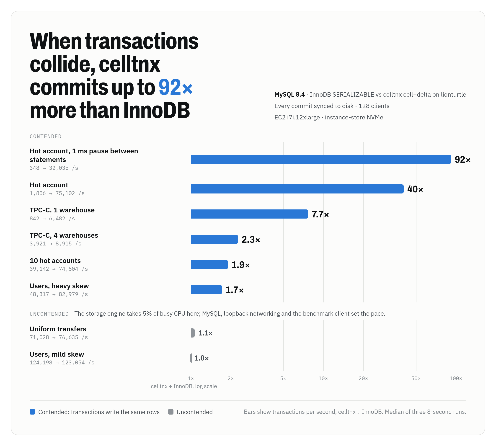
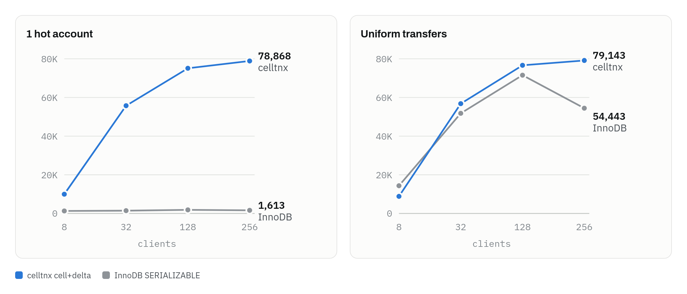

# celltnx

celltnx is a MySQL 8.4 storage engine that runs every transaction at SERIALIZABLE and tracks conflicts per (row, column) cell. It merges rows at commit and lets increments such as `balance = balance + 10` commute, so transactions that share a hot row still commit side by side. Rows live in memory, and [lionturtle](https://github.com/danthegoodman1/lionturtle) stores them durably.

Against InnoDB at SERIALIZABLE in the same server, with every commit synced to disk, celltnx runs a hot account 40 times as fast and TPC-C at one warehouse 7.7 times as fast. Without contention the two tie, because MySQL, the network and the client set the pace.

<picture>
  <source media="(prefers-color-scheme: dark)" srcset="docs/images/speedup-dark.png">
  
</picture>

[BENCHMARKS.md](BENCHMARKS.md) has every result, the profiles and the commands to reproduce them. [DESIGN.md](DESIGN.md#compared-with-innodb) details how celltnx differs from InnoDB.

**Status: experimental.** celltnx passes its simulation sweeps, sanitizer builds and MTR suite, and has run in tests and benchmarks only.

## Features

**Cell-level conflicts.** Two transactions on the same row conflict only when one writes a column the other read. TPC-C's NewOrder and Payment update different columns of the same district row, and both commit.

**Commuting increments.** `UPDATE … SET c = c + k` becomes a delta that writes the cell without reading it, when nothing else in the statement reads `c`, so concurrent increments of one balance all commit. CHECK constraints run again on the merged row at commit, so `CHECK (balance >= 0)` still holds.

**Serializable without locks.** Transactions read a snapshot, and their reads and writes take no locks. A commit validates every cell it read against later commits under one global lock, held for 4–12 µs. A conflict returns error 1213, `ER_LOCK_DEADLOCK`, which existing retry loops already handle.

**Queued read-modify-writes.** `SELECT … FOR UPDATE` by primary key waits on an advisory row lock, so a hot counter such as TPC-C's next order ID queues instead of rerunning after a conflict.

**Group commit.** One writer thread writes every queued commit to lionturtle as one atomic batch and one sync. After each sync it waits for the clients it just acknowledged, at most as long as the sync took, so a drive with power-loss protection pays almost nothing for the wait.

**Checked by deterministic simulation.** A seeded simulator runs the core through crashes, failed syncs and commits interleaved mid-install, and checks every history for serializability. Sweeps run 30,000 seeds per workload, the simulator must find each of 15 deliberate bugs, and a failing seed replays exactly. An MTR suite tests the engine inside MySQL.

## Performance

These runs used an EC2 i7i.12xlarge (48 vCPUs, one instance-store NVMe drive with power-loss protection), with InnoDB and celltnx in one MySQL 8.4.13 server and the benchmark client on the same machine. Every commit syncs before it is acknowledged. Transactions per second at 128 clients:

| Workload | InnoDB SERIALIZABLE | celltnx cell+delta | Speedup |
|---|--:|--:|--:|
| Hot account, 1 ms pause between statements | 348 | 32,035 | 92× |
| Hot account | 1,856 | 75,102 | 40× |
| TPC-C, 1 warehouse | 842 | 6,482 | 7.7× |
| TPC-C, 4 warehouses | 3,921 | 8,915 | 2.3× |
| 10 hot accounts | 39,142 | 74,504 | 1.9× |
| Users, heavy skew (θ=0.99, 50% disjoint) | 48,317 | 82,979 | 1.7× |
| Uniform transfers | 71,528 | 76,635 | 1.1× |
| Users, mild skew (θ=0.5) | 124,198 | 123,054 | 1.0× |

Contention sets the gap. A hot account holds InnoDB under 2,000 transfers a second at every client count, while celltnx merges the balance increments at commit and runs it as fast as uniform transfers. Ledger transfers per second:

<picture>
  <source media="(prefers-color-scheme: dark)" srcset="docs/images/scaling-dark.png">
  
</picture>

Without contention, the storage engine is not the limit. In a profile of an uncontended 128-client run, celltnx and lionturtle take 5% of the busy CPU. The kernel's loopback networking and thread wake-ups take 38%, MySQL's parser, executor and protocol 36%, and the benchmark client 20%, while half the machine sits idle. Every transaction makes several round trips between the client and MySQL, and those round trips set the pace for both engines. InnoDB reaches the same rate on 2.3 times the CPU.

### Trade-offs

- **Low concurrency.** Each commit hands off to the store's writer thread and waits to be woken, so at 8 clients InnoDB commits 1.6 times as fast: 14,336 uniform transfers a second against 8,848.
- **Memory.** Every row stays in memory, so a table must fit in RAM. lionturtle holds the durable copy.
- **Retries without deltas.** A hot read-modify-write that is neither a delta nor a `FOR UPDATE` read reruns after a conflict at commit. In `row` and `cell` modes, a hot account retries about six times per transfer; at 32 clients without fsync that still runs 3.5 times InnoDB's rate, and a fifteenth of `cell+delta`'s.
- **Scope.** The engine lacks XA, foreign keys, partitioning, replication, online backup and atomic DDL, and a transaction writes either celltnx tables or InnoDB tables.

## Compared with InnoDB

| | celltnx | InnoDB |
|---|---|---|
| Concurrency control | Optimistic: validate at commit | Locking: row and gap locks held until commit |
| Conflict unit | (row, column) cell, plus key-range buckets for scans | Row, plus gaps for range reads |
| `c = c + k` | A delta that commutes with other deltas | An exclusive lock on the row |
| Isolation | SERIALIZABLE always | READ UNCOMMITTED through SERIALIZABLE |
| Where conflicts surface | 1213 at commit, or when a `FOR UPDATE` wait refreshes the snapshot | 1213 on deadlock and 1205 on lock timeout, during statements |
| `SELECT … FOR UPDATE` | Advisory lock on primary-key reads, then a snapshot refresh | Exclusive row lock |
| Data | Every row in memory; lionturtle holds the durable copy | Buffer pool over on-disk B+trees |
| Commit | One writer batches commits into one lionturtle write and sync | Redo log; concurrent commits share a flush |
| Index types | Primary, secondary and unique | Also prefix, full-text and spatial |
| Columns per table | 63 | 1,017 |

## Quick start

```console
bench/build-mysql.sh release             # MySQL 8.4.13 with ha_celltnx.so
build=~/.cache/celltnx/build-release
$build/bin/mysqld --no-defaults --initialize-insecure --datadir="$PWD/data"
$build/bin/mysqld --no-defaults --datadir="$PWD/data" --plugin-dir="$build/plugin_output_directory" --plugin-load-add=ha_celltnx.so &
$build/bin/mysql -uroot
```

```sql
CREATE DATABASE bank;
USE bank;
CREATE TABLE accounts (id BIGINT PRIMARY KEY, balance BIGINT NOT NULL, CHECK (balance >= 0)) ENGINE=CELLTNX;
INSERT INTO accounts VALUES (1, 1000), (2, 1000);

START TRANSACTION;
UPDATE accounts SET balance = balance - 10 WHERE id = 1;  -- a delta: commutes with other transfers
UPDATE accounts SET balance = balance + 10 WHERE id = 2;
COMMIT;  -- error 1213 on a conflict: rerun the transaction
```

The build needs GCC, CMake, Ninja, Bison, OpenSSL, libaio, libtirpc and Rust; `bench/build-mysql.sh` fetches MySQL and lionturtle into `~/.cache/celltnx`.

## Configuration

System variables, with defaults:

| Variable | Default | Effect |
|---|---|---|
| `celltnx_mode` | `cell+delta` | Conflict tracking: `row`, `cell` or `cell+delta`. Read-only. |
| `celltnx_bucket_bits` | 0 | Low key bits each phantom-tracking bucket spans. Read-only. |
| `celltnx_durable` | ON | Keep tables in a lionturtle store under `<datadir>/celltnx`; OFF keeps them in memory only. Read-only. |
| `celltnx_sync` | ON | Acknowledge a commit once it is synced; OFF acknowledges it once visible. Read-only. |
| `celltnx_commit_delay_us` | 0 | Microseconds the writer waits before each flush, so more commits share a sync. |
| `celltnx_group_wait_us` | 500 | Microseconds the writer may wait after each sync for the clients it acknowledged to commit again; it waits no longer than that sync took. |
| `celltnx_lock_wait_ms` | 1000 | How long a `SELECT … FOR UPDATE` waits for another transaction's row lock; 0 never waits. |

## Documentation

- [DESIGN.md](DESIGN.md): the data model, the commit protocol, durability and recovery, how the engine maps MySQL onto the core, the deterministic simulator, and how celltnx differs from InnoDB.
- [BENCHMARKS.md](BENCHMARKS.md): every benchmark result, CPU profiles, the setup, and the commands to reproduce them.
- [PLAN.md](PLAN.md): the development plan, with the evidence for each finished item and the work that remains.

## Development

```console
./ci.sh                                           # tests in debug, ASan and TSan; golden traces; 30,000-seed sweeps; self-test
cmake --preset release && cmake --build --preset release --target sim
build/release/sim -seeds 30000 -workload tpcc     # one sweep
build/release/sim -seed 1234                      # replay one seed
sim/golden.sh                                     # this tree's simulator traces against the last commit's
store/lionturtle/check/run.sh ~/ltcheck           # lionturtle under engine-shaped load, kill -9 and failed syncs
(cd ~/.cache/celltnx/build-release/mysql-test && ./mtr --suite=celltnx)
bench/compare-mysql.sh out.csv 8s 3 1             # InnoDB and every celltnx mode, fsync per commit
bench/median.sh out.csv                           # median of each configuration's runs
```

| Path | Contents |
|---|---|
| `core/` | transactions, multiversion rows, skiplists, secondary indexes, the commit protocol and the durability queue |
| `engine/` | the MySQL handler, `ha_celltnx.cc`, and its MTR suite |
| `store/lionturtle/` | the lionturtle store, its fetch script and its stress and crash checks |
| `check/` | operation recorder and serializability checker |
| `workload/` | the random, users and TPC-C workloads |
| `sim/` | the deterministic simulator |
| `tests/` | unit, scenario and stress tests |
| `bench/` | the MySQL build and benchmark scripts, the `sqlbench` client, and results |
